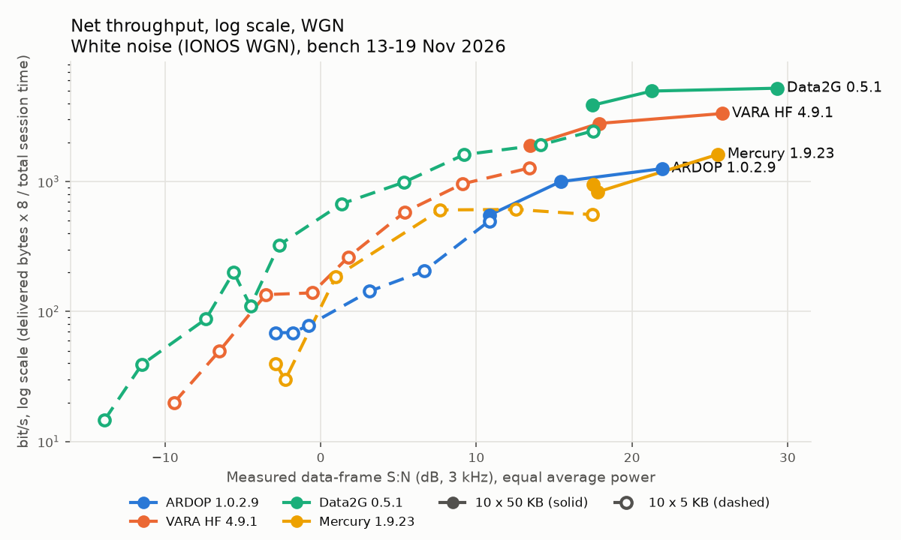
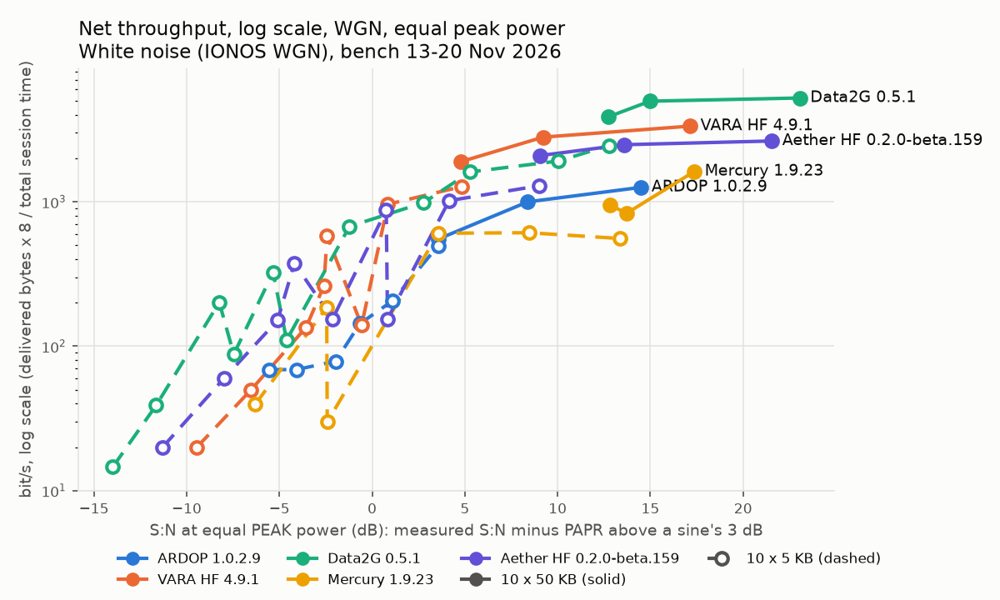

# HF modems for Winlink in white noise: interim report

**ARDOP, Mercury, Data2G, VARA HF and Aether HF, measured on one bench, 13-20 November 2026**

Status: interim. Every result here is in white noise only (a steady, non-fading channel).
Fading channels, which are closer to real HF, come next and may change the picture.
More modems are still to be tested.

## The short answer

| | Fastest in good conditions | Works lowest in poor conditions | Problems seen |
|---|---|---|---|
| **Data2G 0.5.1** | 1st: 5,233 bit/s | 1st: still delivering at −13.9 dB | none in 409 messages |
| **VARA HF 4.9.1** | 2nd: 3,341 bit/s | 3rd: last delivery at −9.4 dB | 1 corrupted message (caught by Winlink) in 320 |
| **Aether HF 0.2.0-beta.159** | 3rd: 2,637 bit/s | 2nd: last delivery at −11.3 dB | none in 339 messages |
| **Mercury 1.9.23** | 4th: 1,621 bit/s | about −3 dB (4 of 10 delivered there) | the receiving modem froze in 8 of 16 long sessions; 1 corrupted message (caught) |
| **ARDOP 1.0.2.9** | 5th: 1,259 bit/s | about −3 dB (all delivered there), nothing at −6 dB | 6 corrupted messages (caught by Winlink) in 328, all at 15-18 dB |

All throughput figures are **net**: message bytes delivered × 8, divided by the whole
session time from connect to disconnect, which is what a user waits for.

- **Data2G was fastest at every signal-to-noise ratio (S:N) we tested**, and kept
  delivering further down than any other modem. It delivered every message in every
  sweep, with no corruption and no hangs.
- **VARA HF was a clear second** in good conditions: about 60-70 % of Data2G's speed and
  roughly 2-3 times ARDOP's. It delivered down to −9.4 dB.
- **Aether HF came third in good conditions and second at the bottom.** VARA is faster at the
  same S:N above about 15 dB; from about 5 to 12 dB the two are level, and Aether kept
  delivering about 2 dB further down (−11.3 dB). Like Data2G, it delivered every message in every
  sweep with no corruption and no hangs. Its connect takes 12 s, the slowest here.
- **ARDOP and Mercury were well behind** in speed, and both stopped around −3 dB.
  Mercury was faster than ARDOP in some conditions and slower in others; its receiver
  freezes are fixed in Mercury's code but not yet released.

## Net throughput

Solid lines: ten 50 KB messages per run. Dashed lines: ten 5 KB messages per run. The
x-axis is the S:N **measured at the receiver** for each modem's own data frames (3 kHz
bandwidth), not the simulator's setting, so each modem is placed where its signal
really was.

Net throughput in bit/s, with the measured S:N in brackets:

| Conditions | ARDOP 1.0.2.9 | Mercury 1.9.23 | Data2G 0.5.1 | VARA HF 4.9.1 | Aether HF 0.2.0-b159 |
|---|---|---|---|---|---|
| Best the bench allows (50 KB) | 1,259 (21.9 dB) | 1,621 (25.5 dB) | 5,233 (29.4 dB) | 3,341 (25.8 dB) | 2,637 (28.8 dB) |
| Good, 15-18 dB (50 KB) | 999 (15.4) | 834-949 (17.5-17.8) | 3,869 (17.5) | 2,803 (17.9) | 2,090 (16.3) |
| About 11-14 dB (5 KB) | 499 (10.8) | 611 (12.6) | 1,916 (14.1) | 1,274 (13.4) | 1,018 (11.4) |
| About 7-9 dB (5 KB) | 206 (6.7) | 606 (7.7) | 1,611 (9.2) | 961 (9.1) | 875 (6.4) |
| About 1-5 dB (5 KB) | 143 (3.1) | 186 (1.0) | 987 (5.3), 675 (1.3) | 582 (5.4), 262 (1.8) | 375 (1.5) |
| About −3 dB (5 KB) | 69 (−2.9) | 40 (−2.9) | 325 (−2.7) | 135 (−3.5) | 155 (−1.9) |
| Time to connect | 6-7 s | 8 s | 4-5 s | 8-9 s | 12 s |

The bench's best S:N differs by modem (22-29 dB) because each runs at its own level (see
"Keeping the test fair"). The top row is each modem's top speed on this bench, not a
measurement at the same S:N.

## Robustness: how low each modem still works

Below about −3 dB, each modem that was still working had its transmit level turned down
in steps, with the noise fixed, until a step delivered nothing in two hours. Each step
queued ten 5 KB messages and allowed one hour per run.

| Measured S:N | ARDOP 1.0.2.9 | Mercury 1.9.23 | Data2G 0.5.1 | VARA HF 4.9.1 | Aether HF |
|---|---|---|---|---|---|
| About −3 dB | 21 delivered, 69 bit/s | 4 of 10, 40 bit/s | all, 325 bit/s | all, 135 bit/s | all, 155 bit/s (−1.9 dB); all, 151 bit/s (−4.8 dB) |
| About −6 dB | **nothing** (−6.0 dB) | not tested further | all, 201 bit/s (−5.6 dB) | 5 an hour, 50 bit/s (−6.5 dB) | 6 an hour, 60 bit/s (−8.0 dB) |
| About −7.5 to −9.5 dB | | | 9 an hour, 88 bit/s (−7.4 dB) | 2 an hour, 20 bit/s (−9.4 dB) | |
| About −11.5 to −12.5 dB | | | 4 an hour, 39 bit/s (−11.5 dB) | **nothing** (−12.4 dB) | 2 an hour, 20 bit/s (−11.3 dB) |
| About −14 dB | | | 1-2 an hour, 15 bit/s (−13.9 dB) | | **nothing** (−13.9 dB) |

Data2G's last step still delivered, so its true limit is somewhat below −13.9 dB.
Mercury was not stepped down this way: its testing ended before this method was set up.
It did deliver 3 of 10 messages at the simulator's out-of-spec noise setting (see
below), where its measured S:N read −9.9 dB, but that reading is uncertain (Mercury's
bursts are timed from its own transmit log, which may include silence). So Mercury's
true limit may be lower than −3 dB; it will be measured in the re-test.

## Reliability

Every delivered attachment was compared byte for byte with what was sent: all of
them (over 1,700 across the five modems) matched. No modem delivered bad data. The failures below were all caught by
Winlink's own checks, and in each case the session ended and the message had to be
sent again.

- **ARDOP 1.0.2.9:** 6 corrupted messages in 328 (1.8 %), all in its 16QAM mode at
  15-18 dB (about 9 % of messages there), none below 15 dB. The cause is in ARDOP
  1.0.2.9's frame check: a weak CRC, and Reed-Solomon parity not checked when the CRC
  passes (details in the results log). A newer ARDOP (1.0.3.3) is to be tested next.
- **Mercury 1.9.23 and 1.9.24:** the receiving station's Mercury froze in **8 of 16 long
  sessions** (ten 50 KB messages, good conditions). A frozen session delivered on
  average 3.4 of its 10 messages. It never froze in short-message sessions. Mercury's
  developers have merged fixes (the freeze, and an issue with Winlink's 5-minute timer)
  that are not yet in a release; Mercury will be re-tested when they are. Separately, one
  message was corrupted at the bench's best S:N and caught by Winlink. Because of the
  freezes, Mercury's 5 KB sweep was cut to one run per setting (three for the others).
- **VARA HF 4.9.1:** one corrupted message in 320. Exactly one byte was lost inside
  VARA's link, and Winlink rejected the message. It did not happen again in the 311
  messages after it.
- **Data2G 0.5.1:** no corruption, no failed session and no hang in 409 messages.
- **Aether HF 0.2.0-beta.159:** no corruption, no failed session and no hang in 339 messages.

## Keeping the test fair

- **Measured S:N, not the simulator setting.** Each modem's data frames were measured
  at the receiving sound card, with the noise taken from the quiet gap after each run.
  Modems put different power into their data frames at the same setting, so the
  results are plotted against what the receiver actually got.
- **Equal average power.** Each modem's data level was set to the same average power,
  against a reference tone. Two modems couldn't reach it. VARA HF's peaks drove the
  simulator's input into the red at that level, so it was turned down 3 dB until no red
  showed. Aether HF holds its peak level, and the reference would have clipped; it ran as
  close as its peaks allowed (received about 0.9 dB under the reference, IONOS peaks about
  950 mV p-p, no red). Because the axis is measured S:N, both are still placed correctly.
- **Equal peak power: a second view.** A real transmitter is limited by its peaks, not
  its average. A modem whose signal has high peaks compared with its average (a high
  crest factor) must run at a lower average power on a real radio. We measured each
  modem's crest factor digitally at its sound-card output. VARA's fast modes have the
  highest (about 11.7 dB), then Aether's OFDM modes (about 10.2 dB). The slow FSK modes of
  VARA and Aether, ARDOP's 4FSK and the FSK modes of Mercury and Data2G are near 3 dB, the
  same as a plain sine wave.

In the equal-peak view each point is moved left by its crest factor above a sine's
3 dB. Data2G stays ahead everywhere. In good conditions its lead over VARA grows (by
about 2.4 dB, because VARA's peaks are higher). In poor conditions VARA's
constant-envelope FSK gains on Data2G's QPSK modes, but not on Data2G's own FSK modes.
VARA's line zig-zags here because it chooses its speed from the average S:N it sees.
How it would choose on a peak-limited transmitter was not tested.

## What this test does and doesn't show

- **White noise only.** No fading, no multipath, no interference. Real HF fades, and
  modems that do well in steady noise may rank differently in fading channels. Fading
  tests (CCIR channels) are next.
- **One bench, one direction.** Two Winlink Express instances on one Windows PC, linked
  through an IONOS HF channel simulator, sending peer-to-peer in one direction (station
  2 to station 1). No transmitter or radio was involved.
- **Simulator range.** The simulator's highest noise setting (WGN −10) overloads its own
  output with any signal on top, so results there are left off the charts. That is why
  the lowest steps above were reached by turning the modem down, not the noise up.
- **Winlink's 5-minute timer.** In peer-to-peer sessions, Winlink Express ends a VARA-type
  session after 5 minutes without new data from it, even mid-message. A small relay on
  the bench held that disconnect for VARA HF, Mercury and Data2G so long sessions could
  finish, as they do with ARDOP. Without it, long messages at low S:N would fail.
- **Versions.** Results apply to the versions named. VARA HF was registered at both
  ends (full speed). Aether HF is a beta with frequent releases; one release was used
  throughout.
- **Settings changed from a modem's defaults** for the bench: busy detection off for every
  modem; for Aether HF also its busy reports to Winlink (they held Winlink's calls) and its
  default upload of session recordings and logs to the Aether project.

## What's next

1. Modem73, same tests.
2. ARDOP's next development build (1.0.3.3 was stopped after its 50 KB sweep for a newer
   build) and ULTRA (paused: it answers its own signal on this bench; reported to its
   developer).
   Modem73 was not tested: as released it is a KISS packet modem with no ARQ or Winlink
   interface, so Winlink Express can't use it like the others.
3. Mercury, re-tested on its next release.
4. Fading channels (CCIR) for every modem.

## Methods and data

The full record, including every run, every finding and every bench fault, is in
[results-log.md](results-log.md). The test plan and decisions are in
[test-plan.md](test-plan.md). Per-run data (run sheets, results, measured S:N, crest
factors) is in [data/](../data/), and the chart data is in
[charts/interim-wgn/points.csv](charts/interim-wgn/points.csv). The raw logs are
published as GitHub release assets.
