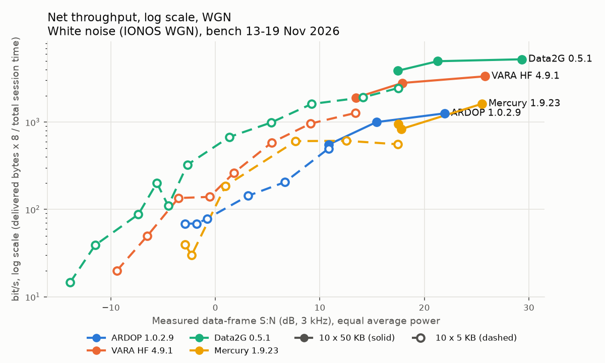
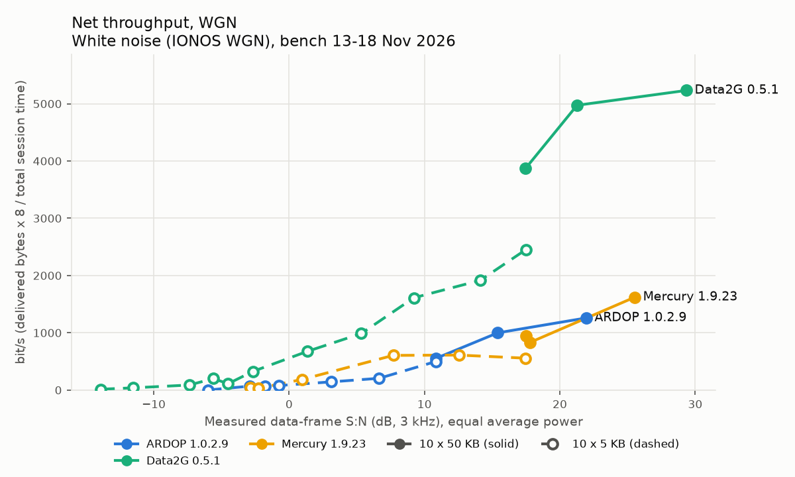
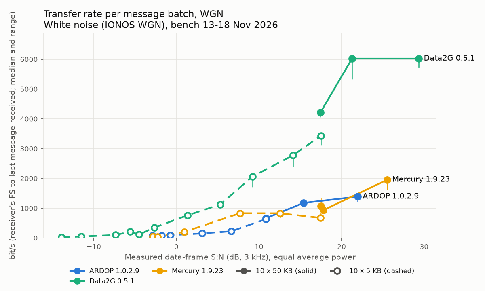
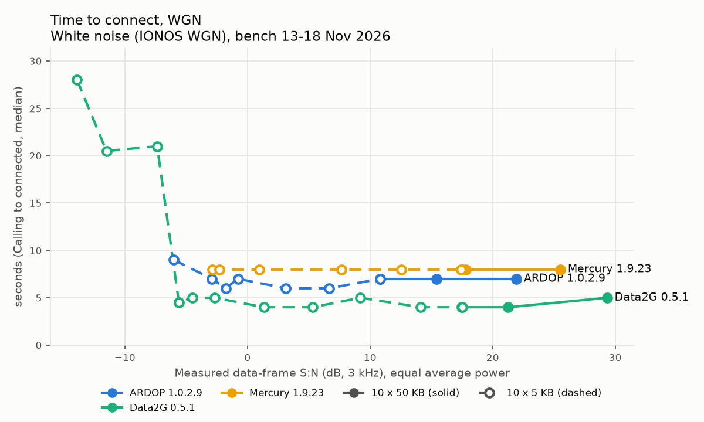
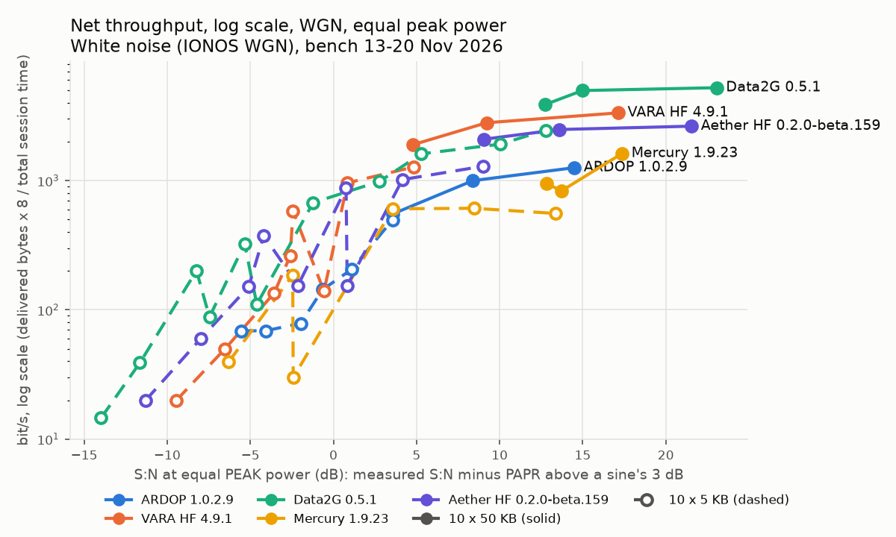

# HF modems for Winlink in white noise: full report

**ARDOP, Mercury, Data2G, VARA HF and Aether HF on one bench, 13–20 November 2026**

This report gives every result from the white-noise stage of hf-modem-bench, how each was
measured, and how far each can be trusted. Its purpose is to help Winlink users choose a modem.
A shorter summary is in [interim-report-wgn.md](interim-report-wgn.md). The day-by-day record,
including every fault, is in [results-log.md](results-log.md).

**Scope.** Every result here is in white noise only: a steady channel with no fading and no
multipath. Real HF fades, and the order can change in fading channels, which are tested next.
Results apply to the versions named.

## Contents

1. [Summary](#1-summary)
2. [Modems](#2-modems)
3. [How the tests were done](#3-how-the-tests-were-done)
4. [Results compared](#4-results-compared)
5. [Results by modem](#5-results-by-modem)
6. [Fairness and limitations](#6-fairness-and-limitations)
7. [Data and reproducibility](#7-data-and-reproducibility)

## 1. Summary

| Modem | Top speed (net) | Lowest S:N still delivering | Integrity and stability | Connect |
|---|---|---|---|---|
| **Data2G 0.5.1** | **5,233 bit/s** (29.4 dB) | **−13.9 dB** (15 bit/s; its limit is lower) | no corruption, no hang in 409 messages | 4–5 s |
| **VARA HF 4.9.1** | 3,341 bit/s (25.8 dB) | −9.4 dB (20 bit/s); nothing at −12.4 dB | 1 corrupted message in 320, caught by Winlink | 8–9 s |
| **Aether HF 0.2.0-beta.159** | 2,637 bit/s (28.8 dB) | −11.3 dB (20 bit/s); nothing at −13.9 dB | no corruption, no hang in 339 messages | 12 s |
| **Mercury 1.9.23** | 1,621 bit/s (25.5 dB) | about −3 dB | receiver froze in 8 of 16 long sessions; 1 corrupted message, caught | 8 s |
| **ARDOP 1.0.2.9** | 1,259 bit/s (21.9 dB) | about −3 dB; nothing at −6.0 dB | 6 corrupted messages in 328, caught, all at 15–18 dB | 6–7 s |

Speeds are **net**: message bytes delivered × 8, divided by the whole session time from connect
to disconnect. That is what a user waits for. S:N is the signal-to-noise ratio **measured at
the receiver** for each modem's own data frames, in a 3 kHz bandwidth.

- **Data2G** was fastest at every S:N and also worked lowest. It delivered every message in
    every sweep.
- **VARA HF** was second in good conditions. At the same S:N above about 15 dB it was about
    25–35 % faster than Aether HF.
- **Aether HF** was third in good conditions. From about 5 to 12 dB it was level with VARA, and
    it kept delivering about 2 dB lower than VARA. Like Data2G, it had no corruption and no
    failures. It was the slowest to connect.
- **Mercury and ARDOP** were well behind in speed and stopped working at about −3 dB. Mercury's
    receiver freezes are fixed in its code but not yet in a release. ARDOP's corruptions come from
    a weak frame check in 1.0.2.9 ([results log](results-log.md)).
- No corrupted message ever reached a user: every corruption was caught by Winlink. Every
    delivered attachment, over 1,700 in all, matched what was sent byte for byte.

## 2. Modems

| Modem | Version | Interface to Winlink Express | Bench level setting | Notes |
|---|---|---|---|---|
| ARDOP | 1.0.2.9 (bundled with Winlink) | Ardop P2P (Winlink starts the TNC) | `DriveLevel` 90 | busy detector off |
| Mercury | 1.9.23 | Vara HF P2P (VARA-compatible TCP) | `tx_gain_db` +3.5 / +3.0 | 1.9.24 also tried (same freezes) |
| Data2G | 0.5.1 | Vara HF P2P | `output_volume` −1 | no switch for its busy detector |
| VARA HF | 4.9.1, registered at both ends | Vara HF P2P | ALC drive −3 | both ends VA3ZTF (one licence) |
| Aether HF | 0.2.0-beta.159 | Vara HF P2P (`aetherd`, headless) | `tx_level` 0.35 | busy reports and default project upload off |

**Not in this report's results:**

**ARDOP 1.0.3.3**, a development build (48f2ae5, not public). Only its 50 KB sweep was run
before testing stopped for a newer build. It uses a new OFDM waveform. Results so far, 84 of 86
delivered, all identical:

| Measured S:N | Net (bit/s), 3 runs |
|---|---|
| 24.4 dB | 1,110 / 1,110 / 1,009 |
| 16.4 dB | 1,107 / 1,096 / 993 |
| 11.9 dB | 1,041 / 1,033 / 1,048 |

In the run at 1,009 and the run at 993, the session ended early. The sender's 60-second
inactivity timeout ran out while it was repeating a 26-second frame. Reported to its developer.

- **ULTRA 0.6.2-pre-alpha**: paused. On this bench each station hears its own signal (section 3),
    and ULTRA answered its own transmissions in an endless loop. Its TNC could also stay stuck after
    a failed session. Reported to its developer
    ([secup/ProjectUltra#38](https://github.com/secup/ProjectUltra/issues/38)).
- **Modem73 2.5.0**: skipped. As released it is a KISS packet modem, with one fixed mode chosen
    by the operator, no ARQ and no Winlink host interface. Winlink Express can't drive it like the
    others. The one Winlink-capable fork (modem73fm) is built for FM radios on Linux.
- **Quicksilver**: skipped. Its developer reported it wasn't ready for testing.

## 3. How the tests were done

### The bench

- **Two Winlink Express 1.8.6.0 instances** on one Windows 10 PC. Station 1 is `C:\RMS Express`,
    callsign VA3ZTF. Station 2 is a second install, callsign VE3XZQ (VA3ZTF for VARA HF). Each
    station has its own USB sound card: station 1 a C-Media (Syba), station 2 a C-Media-based
    Sabrent.
- **One IONOS HF channel simulator** (Teensy, firmware 2.03) between them, wired for half-duplex
    as in its manual. Each station's audio goes into one IONOS channel, and both outputs carry the
    mix. Each station therefore also hears itself. Most modems ignore their own signal; ULTRA didn't.
- **White noise:** IONOS mode WGN, 3 kHz bandwidth, no offset, set over USB for every run.
- **One-way traffic:** station 2 sends and station 1 receives, so data flows in one direction
    and only control frames come back.
- **No radios.** PTT was by VOX (none), and no transmitter was involved.

### Levels

The IONOS adds noise at a fixed level, so the S:N a modem gets depends on how loud its signal is.

- **Calibration:** both stations were set with a 1,500 Hz test tone so that the tone's S:N
    matches the IONOS setting. At WGN 20 they read −0.2 and −0.3 dB, and the tone check was
    repeated before campaigns.
- **Equal average power:** each modem's own level control was then set so its data frames
    arrive at the tone's average power.
- **Exceptions:** VARA HF ran 5.4 dB under that level, because its peaks turned the IONOS level
    meter red. Aether HF ran 0.9 dB under it, because its peaks would otherwise clip; it peaked at
    about 950 mV p-p on the IONOS with no red. ARDOP 1.0.2.9's PSK frames arrive 2.7–6.2 dB under
    its 4FSK frames at the same drive.
- **Why it doesn't matter for the comparison:** all results are plotted against the S:N measured
    at the receiver, not the IONOS setting. A modem that is quieter or louder at a given setting is
    placed where its signal really was.

### Measured S:N

- **What is measured:** a recorder on the bench captures both receiving sound cards during every
    campaign. For each run, the sender's data bursts are found and their power measured at the
    receiver in a 3 kHz bandwidth. Bursts are found from the sender's own log, or from a digital
    loopback of what it played.
- **Noise:** measured in the quiet gap after each run.
- **Data only:** short control frames are not counted.
- **Detail:** the method for each modem is in [data/README.md](../data/README.md).

### Workload and settings

- **Payload:** ten different text messages per run, sent peer-to-peer from station 2 to
    station 1.
    - 50 KB set: 51,200 bytes each.
    - 5 KB set: the first 5,120 bytes of each.
    - Every received attachment is compared byte for byte with what was sent.
- **Sweeps:** the same IONOS settings for every modem, three runs each, in a blocked random
    order (same seed for every modem). Each run is limited to 60 minutes.

  | Sweep | Payload | IONOS WGN settings |
  |---|---|---|
  | Good conditions | 50 KB | 40, 22, 17 |
  | Poor conditions | 5 KB | 17, 12, 7, 2, −2, −5 |

- **Cliff search,** for modems still delivering at WGN −5:
    - the IONOS stays at −5 and the modem's transmit level steps down;
    - each step is two runs of ten 5 KB messages;
    - the search stops at the first step that delivers nothing in two hours.
    - WGN −10, the IONOS's highest noise setting, overloads its own output with any signal on
    top, so it isn't used.
- **Crest runs:** three short messages at eight settings, to measure each modem's transmitted
    peak-to-average power ratio (PAPR) from a digital loopback of its sound-card output.
- **Unattended operation.** A runner on the bench:
    - sets the IONOS;
    - queues messages by import;
    - starts each session and watches it end;
    - recovers if anything hangs (clears both Outboxes, restarts both Winlinks and the modem).
    - All of it is logged.
- **The 5-minute timer.** In peer-to-peer sessions with a VARA-type modem, Winlink Express
    disconnects after 5 minutes without new data, even mid-message. A small relay between station
    2's Winlink and its modem held that disconnect so long, slow sessions could finish, as ARDOP's
    do.
- **Busy detection** was off wherever a modem allows it. Data2G has no switch, but its detector
    didn't block a sweep.

### What "net" and "per message" mean

- **Net:** delivered message bytes × 8 / total session time (connect to disconnect), over the
    ten messages.
- **Per message:** the median of each message's own transfer rate, from the receiving Winlink's
    log. It leaves out connect time and the gaps between messages.
- **Connect:** time from the call to the connection.

## 4. Results compared

### Net throughput

Solid lines are 50 KB runs and dashed lines are 5 KB runs. Each point is the median of its runs.
The cliff steps are the points below about −4 dB.

### Per-message rate

### Time to connect

### Side by side at similar S:N

Net bit/s, with the measured S:N in brackets. The modems' own points don't fall at exactly the
same S:N, so read across with care.

| Conditions | Data2G | VARA HF | Aether HF | Mercury | ARDOP 1.0.2.9 |
|---|---|---|---|---|---|
| Best on this bench (50 KB) | 5,233 (29.4) | 3,341 (25.8) | 2,637 (28.8) | 1,621 (25.5) | 1,259 (21.9) |
| About 20–21 dB (50 KB) | 4,973 (21.3) | | 2,485 (20.8) | | |
| About 15–18 dB (50 KB) | 3,869 (17.5) | 2,803 (17.9) | 2,090 (16.3) | 834–949 (17.5–17.8) | 999 (15.4) |
| About 11–14 dB (5 KB) | 1,916 (14.1) | 1,274 (13.4) | 1,018 (11.4) | 611 (12.6) | 499 (10.8) |
| About 5–9 dB (5 KB) | 1,611 (9.2), 987 (5.3) | 961 (9.1), 582 (5.4) | 875 (6.4) | 606 (7.7) | 206 (6.7) |
| About 1–3 dB (5 KB) | 675 (1.3) | 262 (1.8) | 375 (1.5), 154 (1.1) | 186 (1.0) | 143 (3.1) |
| About −2 to −3.5 dB (5 KB) | 325 (−2.7) | 135 (−3.5) | 155 (−1.9) | 40 (−2.9) | 69 (−2.9) |
| About −5 to −6.5 dB | 201 (−5.6) | 50 (−6.5) | 151 (−4.8) | | **nothing** (−6.0) |
| About −7.5 to −9.5 dB | 88 (−7.4) | 20 (−9.4) | 60 (−8.0) | | |
| About −11.5 dB | 39 (−11.5) | **nothing** (−12.4) | 20 (−11.3) | | |
| About −14 dB | 15 (−13.9) | | **nothing** (−13.9) | | |

### Robustness: how low each modem works

- **Data2G** was still delivering at its last step, −13.9 dB, so its limit is lower than that.
- **Aether HF** delivered at −11.3 dB and nothing at −13.9 dB.
- **VARA HF** delivered at −9.4 dB and nothing at −12.4 dB.
- **ARDOP 1.0.2.9** delivered at about −3 dB and nothing at −6.0 dB.
- **Mercury** wasn't stepped down: its testing ended before the cliff method was set up. It
    delivered 4 of 10 at about −3 dB, and 3 of 10 at the out-of-range WGN −10 setting, where its
    measured S:N (−9.9 dB) is uncertain.

At the bottom, every modem uses a slow, robust mode (FSK, or Aether's 16-FSK floor), and these
modes put more average power into the channel than the fast modes at the same peak level. That
is one reason the measured S:N, not the IONOS setting, is used throughout.

### Equal peak power

A real transmitter is limited by its peaks, not its average, so a modem whose signal peaks high
above its average must run at a lower average power on air. Here each point is moved left by
its PAPR above a sine's 3 dB. These are the PAPRs, at 0.01 %, measured digitally at each sender's
sound card:

| Modem | Fast modes | Slow modes |
|---|---|---|
| VARA HF | about 11.7 dB | FSK about 3 dB |
| Mercury | up to 11.2 dB | 6.4–7.7 dB lower down, 3 dB at the bottom |
| ARDOP 1.0.2.9 | PSK/16QAM about 10.4 dB | 4FSK 4 dB |
| Aether HF | OFDM 10.2 dB (8.7 at mid S:N) | 16-FSK floor 3.3 dB |
| Data2G | 9.3 dB at the top, 5.5–7.7 dB lower down | FSK 3 dB |

- **In this view Data2G is still ahead everywhere,** and its lead over VARA and Aether grows in
    good conditions.
- **VARA keeps its lead over Aether in good conditions,** at about a third faster at equal peak
    power (2,803 against 2,090 bit/s at about 9 dB).
- **At the bottom, VARA's and Aether's constant-envelope FSK modes gain** and overlap Data2G's
    lower modes.
- **No modem here was asked to work peak-limited.** How each would choose its speed on a real,
    peak-limited transmitter wasn't tested.

## 5. Results by modem

Each table lists every point on the charts: the median of its runs, with the measured S:N for the
sender's data frames. "Delivered" counts messages across the runs. A time-limited run counts only
the messages it delivered. Cliff steps hold the IONOS at WGN −5 and lower the modem's own level
setting.

### Data2G 0.5.1

| Payload | IONOS WGN | Step | Measured S:N (dB) | Runs | Delivered | Net (bit/s) | Per message, median (bit/s) | Connect (s) | PAPR (dB) | Equal-peak S:N (dB) |
|---|---|---|---|---|---|---|---|---|---|---|
| 50KB | 40 | sweep | 29.4 | 3 | 30 of 30 | 5,233 | 6,023 | 5 | 9.3 | 23.1 |
| 50KB | 22 | sweep | 21.3 | 3 | 30 of 30 | 4,973 | 6,024 | 4 | 9.3 | 15.0 |
| 50KB | 17 | sweep | 17.5 | 3 | 30 of 30 | 3,869 | 4,221 | 4 | 7.7 | 12.7 |
| 5KB | 17 | sweep | 17.5 | 3 | 30 of 30 | 2,455 | 3,437 | 4 | 7.7 | 12.8 |
| 5KB | 12 | sweep | 14.1 | 3 | 30 of 30 | 1,916 | 2,774 | 4 | 7.1 | 10.1 |
| 5KB | 7 | sweep | 9.2 | 3 | 30 of 30 | 1,611 | 2,062 | 5 | 6.9 | 5.3 |
| 5KB | 2 | sweep | 5.3 | 3 | 30 of 30 | 987 | 1,127 | 4 | 5.5 | 2.8 |
| 5KB | −2 | sweep | 1.3 | 3 | 30 of 30 | 675 | 760 | 4 | 5.6 | −1.2 |
| 5KB | −5 | sweep | −2.7 | 3 | 30 of 30 | 325 | 348 | 5 | 5.7 | −5.3 |
| 5KB | −5 | cliff: output_volume −4 | −5.6 | 2 | 20 of 20 | 201 | 212 | 4 | 5.6 | −8.2 |
| 5KB | −5 | cliff: output_volume −7 | −4.5 | 2 | 20 of 20 | 110 | 115 | 5 | 3.1 | −4.6 |
| 5KB | −5 | cliff: output_volume −10 | −7.4 | 2 | 18 of 18 | 88 | 100 | 21 | 3.1 | −7.5 |
| 5KB | −5 | cliff: output_volume −13 | −11.5 | 2 | 8 of 8 | 39 | 49 | 20 | 3.1 | −11.6 |
| 5KB | −5 | cliff: output_volume −16 | −13.9 | 2 | 3 of 3 | 15 | 22 | 28 | 3.1 | −14.0 |

Delivered every message in both sweeps, with no failed session, no corruption and no hang.
Received about 1 dB above the reference. Its data acknowledgements run about 2 dB hotter again.
At output_volume −7 and below it switches to FSK modes that arrive louder than its −4 step's
modes, which is why that step's measured S:N is higher. Fastest connect of the five. Its cliff
search stopped at its last step (−13.9 dB) while still delivering.

### VARA HF 4.9.1

| Payload | IONOS WGN | Step | Measured S:N (dB) | Runs | Delivered | Net (bit/s) | Per message, median (bit/s) | Connect (s) | PAPR (dB) | Equal-peak S:N (dB) |
|---|---|---|---|---|---|---|---|---|---|---|
| 50KB | 40 | sweep | 25.8 | 3 | 30 of 30 | 3,341 | 3,831 | 9 | 11.7 | 17.1 |
| 50KB | 22 | sweep | 17.9 | 3 | 30 of 30 | 2,803 | 3,225 | 8 | 11.7 | 9.2 |
| 50KB | 17 | sweep | 13.4 | 3 | 30 of 30 | 1,898 | 2,032 | 8 | 11.6 | 4.8 |
| 5KB | 17 | sweep | 13.4 | 3 | 30 of 30 | 1,274 | 1,603 | 8 | 11.6 | 4.8 |
| 5KB | 12 | sweep | 9.1 | 3 | 30 of 30 | 961 | 1,218 | 8 | 11.3 | 0.8 |
| 5KB | 7 | sweep | 5.4 | 3 | 30 of 30 | 582 | 661 | 8 | 10.8 | −2.4 |
| 5KB | 2 | sweep | 1.8 | 3 | 30 of 30 | 262 | 280 | 8 | 7.4 | −2.6 |
| 5KB | −2 | sweep | −0.5 | 3 | 30 of 30 | 139 | 144 | 9 | 3.0 | −0.6 |
| 5KB | −5 | sweep | −3.5 | 3 | 30 of 30 | 135 | 141 | 9 | 3.0 | −3.6 |
| 5KB | −5 | cliff: drive −6 | −6.5 | 2 | 10 of 10 | 50 | 61 | 10 | 3.0 | −6.5 |
| 5KB | −5 | cliff: drive −9 | −9.4 | 2 | 4 of 4 | 20 | 24 | 10 | 3.0 | −9.5 |
| 5KB | −5 | cliff: drive −12 | −12.4 | 2 | 0 of 0 | 0 | – | 10 | 3.0 | −12.4 |

Registered at both ends, so it ran at full speed. Both stations ran as VA3ZTF, the licensed
callsign. Run at ALC drive −3: at the reference level its peaks reddened the IONOS meter.
Sweeps 270 of 270 delivered and identical. One corrupted message, in the smoke test before the
sweeps: one byte was lost inside VARA's link, and Winlink rejected the message. It didn't happen
again in the 311 messages after it. Its fast modes have the highest PAPR here.

### Aether HF 0.2.0-beta.159

| Payload | IONOS WGN | Step | Measured S:N (dB) | Runs | Delivered | Net (bit/s) | Per message, median (bit/s) | Connect (s) | PAPR (dB) | Equal-peak S:N (dB) |
|---|---|---|---|---|---|---|---|---|---|---|
| 50KB | 40 | sweep | 28.8 | 3 | 30 of 30 | 2,637 | 3,309 | 12 | 10.3 | 21.6 |
| 50KB | 22 | sweep | 20.8 | 3 | 30 of 30 | 2,485 | 3,042 | 12 | 10.2 | 13.6 |
| 50KB | 17 | sweep | 16.3 | 3 | 30 of 30 | 2,090 | 2,645 | 12 | 10.2 | 9.1 |
| 5KB | 17 | sweep | 16.2 | 3 | 30 of 30 | 1,292 | 1,947 | 12 | 10.2 | 9.0 |
| 5KB | 12 | sweep | 11.4 | 3 | 30 of 30 | 1,018 | 1,338 | 12 | 10.3 | 4.2 |
| 5KB | 7 | sweep | 6.4 | 3 | 30 of 30 | 875 | 1,048 | 12 | 8.7 | 0.8 |
| 5KB | 2 | sweep | 1.5 | 3 | 30 of 30 | 375 | 414 | 12 | 8.7 | −4.2 |
| 5KB | −2 | sweep | 1.1 | 3 | 30 of 30 | 154 | 170 | 12 | 3.3 | 0.8 |
| 5KB | −5 | sweep | −1.9 | 3 | 30 of 30 | 155 | 170 | 12 | 3.3 | −2.1 |
| 5KB | −5 | cliff: tx_level −3 dB | −4.8 | 2 | 20 of 20 | 151 | 169 | 12 | 3.3 | −5.1 |
| 5KB | −5 | cliff: tx_level −6 dB | −8.0 | 2 | 12 of 12 | 60 | 69 | 12 | 3.0 | −8.0 |
| 5KB | −5 | cliff: tx_level −9 dB | −11.3 | 2 | 4 of 4 | 20 | 32 | 12 | 3.0 | −11.3 |
| 5KB | −5 | cliff: tx_level −12 dB | −13.9 | 2 | 0 of 2 | 0 | – | 74 | 3.1 | −14.0 |

All 339 delivered attachments were identical, with no failed sweep run and no hang. Settings
changed from its defaults:

- Busy reports off. With only `wait_for_clear` off, its detector still told Winlink "busy" after
    the IONOS setting changed, and Winlink held its call.
- Its default upload of session recordings and logs to the Aether project off.
- A regulatory profile set, since Aether transmits nothing without one.

Aether holds each burst's peak level, so its OFDM modes run below its 16-FSK floor mode in
average power. That is why the WGN 2 and WGN −2 points sit at nearly the same measured S:N.
Connect took 12 s every time.

### Mercury 1.9.23

| Payload | IONOS WGN | Step | Measured S:N (dB) | Runs | Delivered | Net (bit/s) | Per message, median (bit/s) | Connect (s) | PAPR (dB) | Equal-peak S:N (dB) |
|---|---|---|---|---|---|---|---|---|---|---|
| 50KB | 40 | sweep | 25.5 | 3 | 20 of 22 | 1,621 | 1,955 | 8 | 11.2 | 17.4 |
| 50KB | 22 | sweep | 17.5 | 3 | 17 of 19 | 949 | 1,073 | 8 | 7.7 | 12.8 |
| 50KB | 17 | sweep | 17.8 | 3 | 27 of 27 | 834 | 937 | 8 | 7.1 | 13.7 |
| 5KB | 17 | sweep | 17.4 | 1 | 10 of 10 | 557 | 674 | 8 | 7.1 | 13.4 |
| 5KB | 12 | sweep | 12.6 | 1 | 10 of 10 | 611 | 829 | 8 | 7.1 | 8.4 |
| 5KB | 7 | sweep | 7.7 | 1 | 10 of 10 | 606 | 830 | 8 | 7.1 | 3.6 |
| 5KB | 2 | sweep | 1.0 | 1 | 10 of 10 | 186 | 205 | 8 | 6.4 | −2.5 |
| 5KB | −2 | sweep | −2.9 | 1 | 4 of 4 | 40 | 49 | 8 | 6.4 | −6.3 |
| 5KB | −5 | sweep | −2.3 | 1 | 3 of 3 | 30 | 40 | 8 | 3.1 | −2.4 |

The receiving station's Mercury froze in 8 of 16 long sessions (ten 50 KB messages); a frozen
session delivered 3.4 of its 10 messages on average. It never froze in short-message sessions.
Because of this its 5 KB sweep was one run per setting, against three for the others. 1.9.24
froze the same way. Its developers have merged fixes that aren't yet released, so Mercury will
be re-tested on its next release. One corrupted message, caught by Winlink, at the bench's best
S:N. The −5 and −2 points are partial deliveries.

### ARDOP 1.0.2.9

| Payload | IONOS WGN | Step | Measured S:N (dB) | Runs | Delivered | Net (bit/s) | Per message, median (bit/s) | Connect (s) | PAPR (dB) | Equal-peak S:N (dB) |
|---|---|---|---|---|---|---|---|---|---|---|
| 50KB | 40 | sweep | 21.9 | 3 | 30 of 30 | 1,259 | 1,388 | 7 | 10.4 | 14.5 |
| 50KB | 22 | sweep | 15.4 | 3 | 20 of 22 | 999 | 1,177 | 7 | 10.0 | 8.4 |
| 50KB | 17 | sweep | 10.8 | 3 | 18 of 18 | 552 | 660 | 7 | 10.3 | 3.6 |
| 5KB | 17 | sweep | 10.8 | 3 | 30 of 30 | 499 | 633 | 7 | 10.3 | 3.6 |
| 5KB | 12 | sweep | 6.7 | 3 | 30 of 30 | 206 | 226 | 6 | 8.6 | 1.1 |
| 5KB | 7 | sweep | 3.1 | 3 | 30 of 30 | 143 | 154 | 6 | 6.8 | −0.7 |
| 5KB | 2 | sweep | −1.8 | 3 | 21 of 21 | 69 | 79 | 6 | 6.8 | −5.6 |
| 5KB | 0 | sweep | −0.8 | 3 | 24 of 24 | 79 | 92 | 7 | 4.2 | −2.0 |
| 5KB | −2 | sweep | −2.9 | 3 | 21 of 21 | 69 | 80 | 7 | 4.2 | −4.1 |
| 5KB | −5 | sweep | −6.0 | 3 | 0 of 6 | 0 | – | 9 | 4.3 | −7.3 |

The WGN 0 point is from an extra run to locate its knee. Six corrupted messages in 328, all in
its 16QAM mode at 15–18 dB (about 9 % of messages there), all caught by Winlink. The cause is
ARDOP 1.0.2.9's frame check: a weak CRC, and Reed-Solomon parity that isn't checked when the
CRC passes. Its 50 KB runs at WGN 17 hit the 60-minute limit at 6 of 10 messages. Nothing was
delivered at −6.0 dB. Its busy detector had to be turned off: it blocked every call at WGN 40.

## 6. Fairness and limitations

- **White noise only.** No fading, no multipath, no interference. Fading (CCIR) tests are next,
    and the ranking may change there.
- **One bench, one direction.** Two Winlinks on one PC, peer-to-peer, station 2 to station 1.
    There was no transmitter, so no ALC, no transmit/receive switching time and no real-radio
    filters.
- **Each station hears itself** on a single half-duplex IONOS. All five modems here cope with
    that; ULTRA didn't.
- **Run counts.** Three runs per setting, except Mercury's 5 KB sweep (one run). Cliff steps are
    two runs each. Small differences between neighbouring points are within run-to-run spread.
- **Different S:N points per modem.** Each modem's signal level differs, so its points fall at
    its own measured S:N. Comparisons between modems are made along the measured-S:N axis, not
    setting by setting. A by-setting comparison favours a modem whose signal arrives louder.
- **Levels.** Equal average power where possible; VARA HF (5.4 dB under) and Aether HF (0.9 dB
    under) are documented exceptions. The axis is measured S:N in every case.
- **Modem settings.** Defaults, except where the bench required otherwise. All changes are listed
    in section 2 and in the results log.
- **Versions.** Each modem was tested on one pinned version. Newer versions may differ, and
    Mercury in particular is expected to.
- **The relay** held Winlink's 5-minute timer disconnect for VARA-type modems. Without it, long
    messages at low S:N would fail in Winlink Express peer-to-peer sessions.
- **Mercury's and ARDOP's limits** are approximate. They were not searched with the cliff method.

## 7. Data and reproducibility

- **Per-run data** (run sheets, results per run and per message, measured S:N, crest factors) is
    in [data/](../data/). The chart data is in
    [charts/interim-wgn/points.csv](charts/interim-wgn/points.csv).
- **Raw logs:** Winlink session logs, modem logs, relay logs, S:N recordings and transmit crest
    logs are attached to the GitHub releases, latest
    [data-20261120](https://github.com/jjones9527/hf-modem-bench/releases/tag/data-20261120). They
    are redacted only for the station's location and the bench computer's identifiers.
- **The full record,** with every bench fault and decision, is in [results-log.md](results-log.md).
    The plan is in [test-plan.md](test-plan.md) and the bench calibration in
    [bench-setup.md](bench-setup.md).
- **The bench software** (runner, IONOS control, S:N and crest measurement) is in this
    repository.
